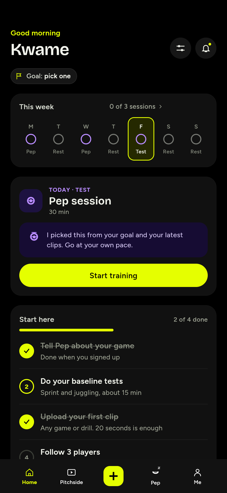

# Tracka: the player app, and Pep, its AI coach

**Tracka** is a mobile app (Android, iPhone, and web) for footballers.
Players create a profile, upload clips of themselves, keep a library of
their videos, and get scored and coached by **Pep**, an AI coach that
measures speed, acceleration, touches, body shape and timed drills,
compares them with players their age, and tells them exactly what to
practise next.

This repo holds both halves:

| Folder | What | Built with |
|---|---|---|
| `app/` | The player app | Flutter (Dart) → Android, iOS, web |
| `pep/` | The API the app talks to (`/v1/...`) and the Pep analysis pipeline | Python, FastAPI, YOLO26, Gemini |

Scope today: **players only**. Scouts, opportunities and feeds come
later (the Opportunities tab is there, empty), as a separate app on the
same API.

**Learning?** Start with [`docs/handbook/00-start-here.md`](docs/handbook/00-start-here.md).
**Finding your way around?** [`docs/CODEMAP.md`](docs/CODEMAP.md).

## Quick start

```bash
# the API + Pep
python -m venv .venv && source .venv/bin/activate
pip install -e ".[dev,vision,coach,train]"
cp .env.example .env
pep serve                                  # http://localhost:8000 (+ Lab console at /lab)
python scripts/seed_demo.py                # optional: demo@tracka.app / tracka-demo-123

# the app (needs Flutter)
cd app && ./tool/setup_platforms.sh
flutter run -d chrome --dart-define=PEP_API_URL=http://localhost:8000

# checks
pytest && ruff check pep tests scripts training deploy && mypy pep
cd app && flutter analyze && flutter test
```

Add `PEP_GEMINI_API_KEY` to `.env` for AI coaching notes; without it Pep
writes rule-based notes.

## How it works

```
App ──► Pep API (/v1: accounts, profile, videos, coach) ──► Postgres job queue ──► GPU workers
                                │                                                     │
                                └──── clips in Cloudflare R2 ◄──────────────────────── ┘

worker: clip → frames → YOLO26 pose + ball → camera-motion removal → pick the player
       → pixels to metres → Kalman/RTS smoothing → metrics (+ drills)
       → norms by age → skills, drills, role fit → Gemini notes (optional)
```

| Part | Runs on | Notes |
|---|---|---|
| Player app | Phones (Play Store / App Store later); web on Cloudflare Pages | `app/`, built by `.github/workflows/app.yml` |
| API | Render (Frankfurt), `Dockerfile` | FastAPI; `/v1` for the app, `/healthz` `/readyz` `/metrics` |
| Queue + data | Render Postgres | `SELECT … FOR UPDATE SKIP LOCKED`, leases, backoff |
| Workers | Modal GPUs (`deploy/modal_app.py`) or Render CPU (`Dockerfile.worker`) | scale to zero on Modal |
| Clips | Cloudflare R2 | presigned URLs, free egress |
| AI coach | Gemini 3.8 Flash | structured JSON, guarded, optional per player |



Screenshots of every screen are regenerated by CI on the
[`screenshots` branch](https://github.com/jnrkufuor/tracka-pep/tree/screenshots).

## Deploying
1. **Render**: New → Blueprint → this repo. `render.yaml` is free (for
   testing: the API sleeps when idle and the database expires after 30
   days); `render.prod.yaml` is the paid launch setup (set it as the
   Blueprint file path). Fill in the values it asks for, including
   `PEP_CORS_ORIGINS` (your web app's address).
2. **Cloudflare R2**: create bucket `pep-clips` and an API token; set the
   `PEP_S3_*` variables.
3. **Modal** (GPU workers): `modal secret create pep-secrets …`, then
   `modal deploy deploy/modal_app.py`.
4. **Web app**: set the Actions variable `PEP_API_URL` and the secrets
   `CLOUDFLARE_API_TOKEN`, `CLOUDFLARE_ACCOUNT_ID`; pushes to `main` deploy
   to Cloudflare Pages.
5. **Android**: CI builds APKs (artifact `tracka-android`); for the Play
   Store, add a signing key. **iOS** needs a Mac and an Apple developer
   account.
6. **GitHub**: branch protection on `main` ([handbook 04](docs/handbook/04-ci-cd.md)).

The older outside-coach contract for tracka-api (`POST /analyses` with a
signed callback) still works; see `pep/contracts.py`.

## Honest limits
- Norms are starter values from research, not Ghanaian data yet.
- Match-clip speeds use a body-height ruler (±10–15%). Drills with cones
  are the fair, comparable measure.
- No event recognition yet (passes, shots, tackles): the AI coach's
  observations stand in, labelled LOW confidence.
- Ultralytics YOLO is AGPL-3.0: read [handbook 12](docs/handbook/12-cost-privacy-next.md)
  before a commercial launch.
